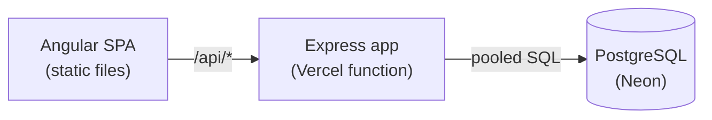

# Helpdesk

[](https://github.com/bjonimerkuri/helpdesk/actions/workflows/ci.yml)
[](https://github.com/bjonimerkuri/helpdesk/actions/workflows/codeql.yml)


A support-ticket system. Customers open tickets and follow the conversation. Agents work the queue: triage, assign,
reply, and move each ticket through a strict status flow.

**[Live demo](https://helpdesk-bay.vercel.app/login)** · demo accounts `customer@example.com`,
`agent@example.com`, `admin@example.com` (password `password123`; the sign-in page has one-click buttons).


## What is interesting here

- **Visibility without leaks.** Customers only ever see their own tickets. Someone else's ticket returns `404`, not
  `403`, so its existence is not revealed. This is covered by an integration test and an end-to-end test.
- **A server-owned state machine.** Status transitions are a pure function with unit tests. The API enforces them (`422`)
  and sends `allowedStatuses` with each ticket, so the UI never duplicates the rules.
- **Real database tests.** Integration tests run the actual SQL against PostgreSQL, including pagination, search and
  wildcard escaping, instead of mocking the driver.
- **Production-minded API.** Fail-fast env validation, `helmet`, request IDs with structured logs (credentials redacted),
  rate-limited auth, pinned JWT algorithm, timing-safe login, `/api/health`, graceful shutdown, versioned SQL migrations
  with an advisory lock.
- **Modern Angular.** Standalone components, signals, new control flow, lazy routes, functional guards and
  interceptors, typed reactive forms, RxJS where it earns its place (debounced search, `switchMap` cancellation).
- **Accessible by default.** Labelled controls, skip link, live regions for errors, visible focus, reduced-motion support,
  status shown as text plus colour, and axe checks in the e2e suite.

## Architecture



More in [docs/architecture.md](docs/architecture.md) (data model, state machine, request flow).

| Layer | Choices |
|---|---|
| Web | Angular 18, RxJS, TypeScript, self-hosted variable font |
| API | Node 20, Express, zod, node-postgres, JWT, bcrypt, pino, helmet |
| Data | PostgreSQL 16 with trigram search indexes |
| Quality | Vitest, Supertest, Playwright, axe, ESLint (with Angular a11y rules), Prettier, GitHub Actions, CodeQL, Dependabot |
| Hosting | Vercel (static + serverless function), Neon Postgres |

## Run it locally

Requires Node 20 and Docker.

```bash
docker compose up -d      # PostgreSQL, with helpdesk and helpdesk_test databases
npm ci
npm run db:migrate && npm run db:seed
npm run dev               # web http://localhost:4200, API http://localhost:3001/api/health
```

| Script | What it does |
|---|---|
| `npm run dev` | API and web app with reload |
| `npm run check` | Format check, lint, typecheck, unit tests, build |
| `npm test` / `npm run test:coverage` | Unit tests for rules, config and helpers |
| `npm run test:int` | API integration tests against PostgreSQL |
| `npm run e2e` | Playwright end-to-end tests (starts both servers, resets the database) |
| `npm run db:migrate` / `db:seed` / `db:reset` | Schema, demo data, wipe and reseed (never in production) |

## Testing strategy

| Level | What it proves | Where |
|---|---|---|
| Unit | Transition table, visibility, config validation, LIKE escaping | `apps/api/src/*.test.ts` |
| Integration | Auth, scoping, 404 vs 403, state machine over HTTP, pagination, search | `apps/api/test/` |
| End-to-end | Real browser flows for customer and agent, plus accessibility scans | `e2e/tests/` |

CI runs three parallel jobs (quality, integration, e2e) with PostgreSQL service containers and uploads the Playwright
report on failure.

## API

All routes are under `/api` and, except auth and health, need `Authorization: Bearer <token>`.

| Method | Route | Access |
|---|---|---|
| GET | `/health` | public (checks the database) |
| POST | `/auth/register`, `/auth/login` | public, rate limited |
| GET | `/tickets?status=&q=&page=&pageSize=` | any user, scoped by role |
| POST | `/tickets` | any user |
| GET | `/tickets/:id` | bjonimerkuri or staff; `404` otherwise |
| PATCH | `/tickets/:id` | staff: status, priority, assignee |
| POST | `/tickets/:id/comments` | bjonimerkuri or staff |
| GET | `/agents` | staff |

Errors are always `{ "error": "message" }` with a meaningful status (`400` validation, `401`, `403`, `404`, `409`, `422`
invalid transition).


5. Put the live URL at the top of this README and replace `bjonimerkuri` in the badges.

