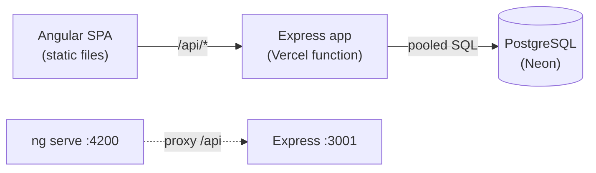
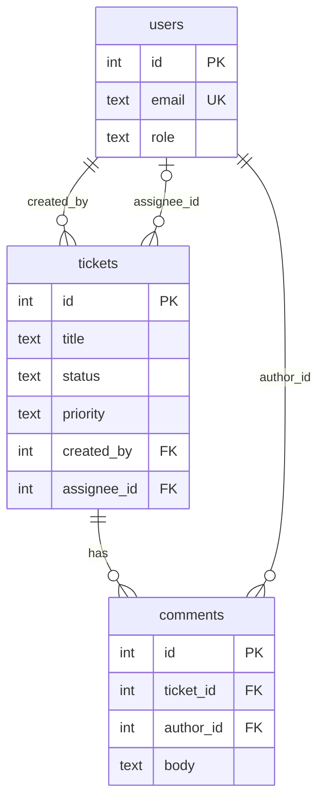
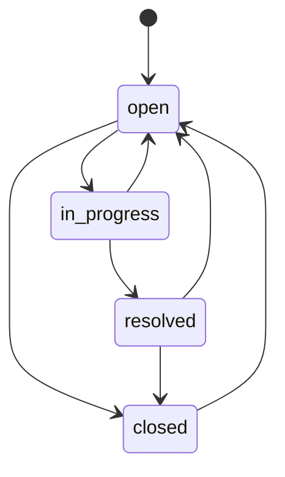
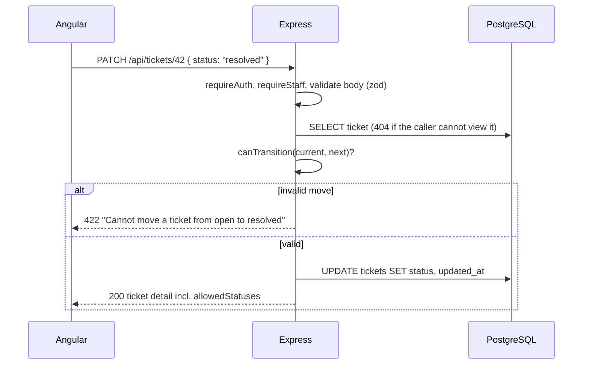

# Architecture

## Runtime

In production the browser, the static files and the function share one origin. Locally, the Angular dev server proxies
`/api` to the API process.

## Data model

## Ticket state machine

## Request flow for a status change

## Where things live

| Concern | Location |
|---|---|
| Business rules (pure, unit-tested) | `apps/api/src/ticket.rules.ts` |
| HTTP routes and validation | `apps/api/src/routes/` |
| Config and fail-fast env validation | `apps/api/src/config.ts` |
| Schema | `apps/api/migrations/*.sql`, applied by `apps/api/src/migrate.ts` |
| Vercel function entry | `api/index.ts` |
| Angular features / core services / shared UI | `apps/web/src/app/{features,core,shared}` |
| Tests | unit `apps/api/src/*.test.ts`, integration `apps/api/test/`, e2e `e2e/tests/` |
